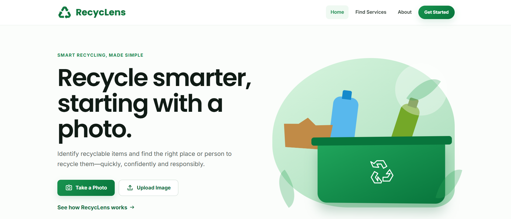
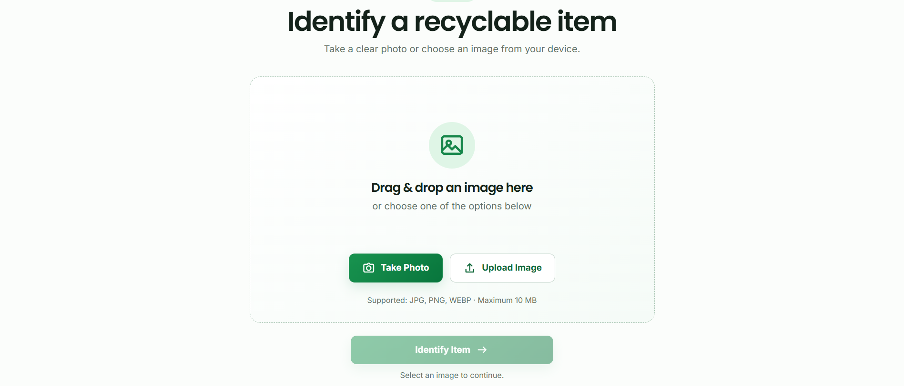
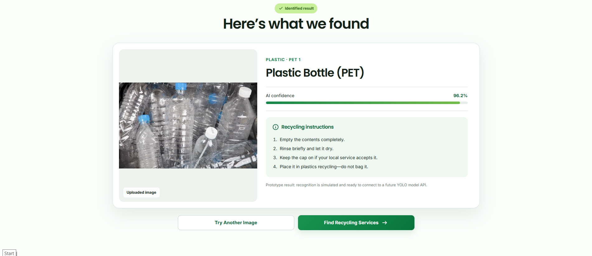
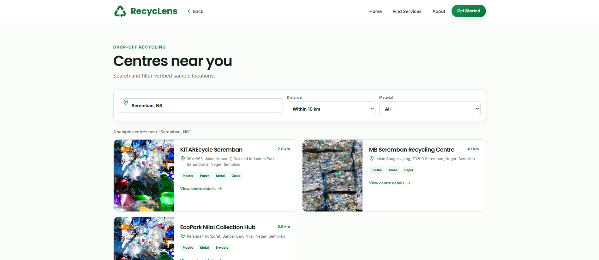
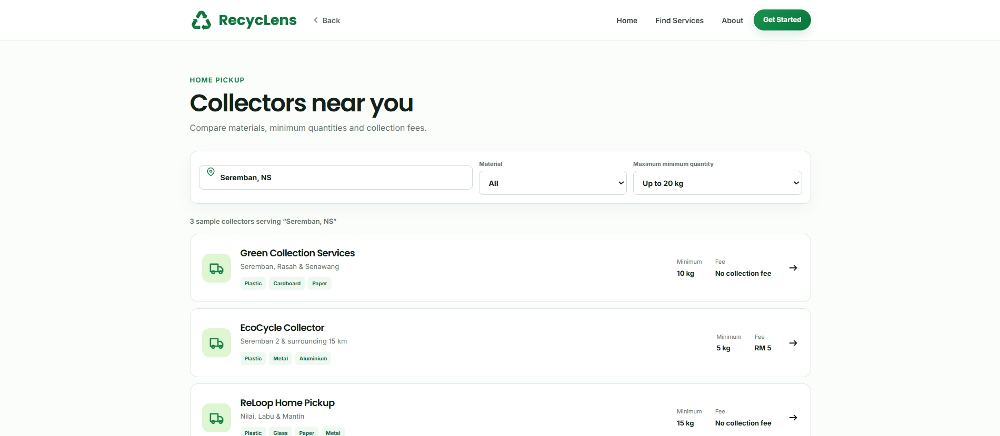

# 🌱 RecycLens
### AI-Powered Recycling Recognition & Collector Connection Platform

RecycLens is a personal project exploring how artificial intelligence and web technology can make recycling easier and more accessible.

The platform aims to help users identify recyclable materials through image recognition, access recycling instructions, discover nearby recycling centres and connect with collectors offering home collection services.

**Project Status:** Interactive Prototype – In Development

## 🎯 Problem Statement

People may struggle to identify recyclable materials, understand proper recycling practices and find convenient recycling services.

RecycLens aims to simplify this process through an accessible web-based platform.

## 💡 Proposed Features

- 📸 Image upload and photo-based material recognition.
- 🤖 AI-assisted recyclable material identification.
- ♻️ Recycling instructions and material information.
- 📍 Recycling centre discovery.
- 🚚 Home collection service discovery.
- 📞 Direct contact with recycling collectors.
- 📝 Collection request submission.

## 🖥️ UI/UX Design

The interface is designed around a simple user journey:

1. Upload or capture an image.
2. View the predicted recyclable material.
3. Read recycling instructions.
4. Choose between recycling centre drop-off or home collection.
5. Contact the relevant recycling provider.

## 🛠️ Tools & Technologies

- Figma
- Figma Make
- Python (AI recognition exploration)
- YOLO / OpenCV (planned recognition integration)
- React / TypeScript (prototype implementation, subject to final code verification)

## 📷 Screenshots

Screenshots of the homepage, image upload interface, recognition result and recycling service pages will be added here.

## 🚧 Development Roadmap

- [x] Initial project concept and planning.
- [x] UI/UX design exploration.
- [x] Interactive website prototype.
- [ ] AI recognition integration.
- [ ] Backend API development.
- [ ] Database implementation.
- [ ] Recycling centre and collector directory.
- [ ] User testing and improvements.

## 🔗 Project Links

- Interactive Prototype: [Insert your Figma Make link]
- UI/UX Design: [Insert your Figma design link]

## 👩‍💻 About the Project

Developed as a personal learning and portfolio project to explore the integration of artificial intelligence, computer vision and web application development.

**Recycle smarter. Make every item count.**

## 📸 UI/UX Design Preview

Here are some of the interface designs for RecycLens.

### Homepage

### Image Upload

### Recognition Result

### Recycling Centres

### Collector Connection

## 🎨 UI/UX Design

Explore the design documentation and interactive prototype:

- [UI/UX Design Documentation](ui-ux-design/README.md)
- [Project Documentation](documentation/README.md)
- [View Figma Prototype](PASTE-YOUR-FIGMA-LINK-HERE)
